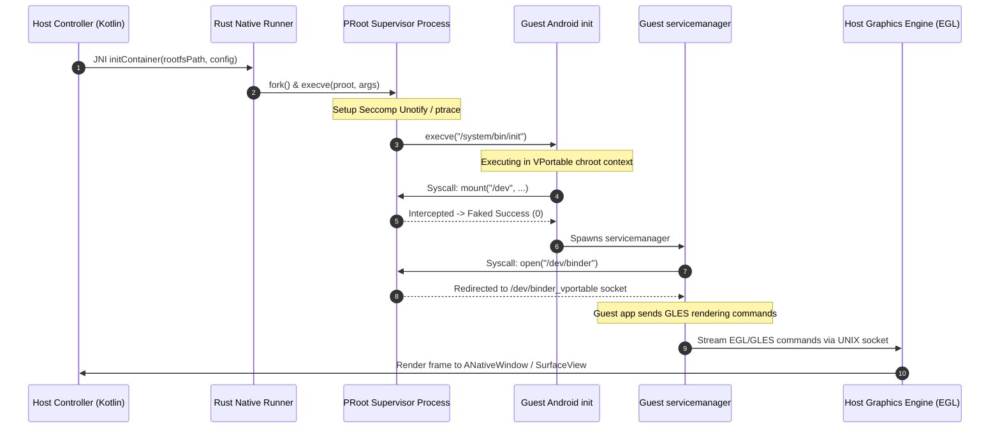

# Architecture Overview: VPortable (`com.m5dev.vportable`)

## 1. Executive Summary & Core Paradigm
**VPortable** is a production-grade, rootless user-space containerization system for Android. Operating under package identifier `com.m5dev.vportable` within the `M5Devs` organization, VPortable executes an isolated guest Android 9 (Pie) runtime environment directly inside a standard unprivileged Android app sandbox without requiring device root privileges, custom kernel modules, or unlocked bootloaders.

### 1.1 Rootless User-Space Containerization vs. Traditional App-Level Sandboxing

Traditional Android virtualization and multi-account sandboxing solutions rely heavily on one of two paradigms:
1. **App-Level API Hooking / Dynamic Reflection (e.g., VirtualApp, Exposed frameworks):** Intercepts Android Framework Java APIs (`ActivityManagerService`, `PackageManagerService`) via dynamic proxies and Java reflection.
   - *Limitations:* Extremely fragile across Android API updates, easily detected by anti-cheat / DRM mechanisms, lacks full POSIX and system-level isolation, cannot run native system daemons (`servicemanager`, `vold`, `installd`).
2. **KVM / Hardware Virtualization (e.g., Android Virtualization Framework - AVF):** Spawns a full Type-2 hypervisor running a full kernel.
   - *Limitations:* Requires hardware virtualization extensions (`/dev/kvm`), root access or OEM-signed privileges, high memory overhead, and strict kernel patch requirements.

**VPortable's Rootless User-Space Containerization Paradigm:**
VPortable leverages user-space syscall interception using Linux ptrace and `seccomp-unotify` via an optimized fork of **PRoot** (`termux/proot`). VPortable presents an entirely isolated root filesystem (`/data/data/com.m5dev.vportable/rootfs`) to guest processes while translating filesystem paths, UID/GID identities, and IPC calls in real-time.

```
+-----------------------------------------------------------------------------------+
|                                Host Android OS                                    |
| +-------------------------------------------------------------------------------+ |
| |                    VPortable Sandbox (`com.m5dev.vportable`)                   | |
| |                                                                               | |
| |  +--------------------+  +--------------------+  +-------------------------+  | |
| |  |   Host UI & App    |  | Virtual Graphics   |  | Container Supervisor    |  | |
| |  |    Controller      |  |     Engine         |  |   (PRoot / Seccomp)     |  | |
| |  +--------+-----------+  +---------+----------+  +------------+------------+  | |
| |           |                        |                          |               | |
| |           | JNI / IPC              | UNIX Socket / EGL        | Syscall Trap  | |
| |           v                        v                          v               | |
| |  +-------------------------------------------------------------------------+  | |
| |  |                     Guest Android 9 (Pie) Rootfs                        |  | |
| |  |                                                                         |  | |
| |  | +-----------------+  +----------------------+  +---------------------+  | |
| |  | | Android `init`  |  | `servicemanager`     |  | Guest Apps / APKs   |  | |
| |  | +-----------------+  +----------------------+  +---------------------+  | |
| |  +-------------------------------------------------------------------------+  | |
| +-------------------------------------------------------------------------------+ |
+-----------------------------------------------------------------------------------+
```

---

## 2. The 4 Core Pillars of VPortable

VPortable is architected around four distinct, decoupled subsystems:

### Pillar 1: Host UI & Controller (`com.m5dev.vportable`)
- **Language & Runtime:** Kotlin / Java on modern Android Jetpack stack.
- **Responsibilities:**
  - Manages container lifecycle (Initialize, Boot, Pause, Stop, Reset).
  - Exposes management UI for guest app installation, storage configuration, and guest setting toggles.
  - Controls guest process bootstrapping and initial environment initialization.
  - Handles Android Lifecycle events (mapping Host `Activity` state changes to Guest power/display state).

### Pillar 2: Container Supervisor (PRoot-Based Engine)
- **Language & Runtime:** C / Rust native executable linked against Bionic libc.
- **Responsibilities:**
  - Intercepts system calls originating from guest processes using `ptrace` and `seccomp(SECCOMP_SET_MODE_FILTER, SECCOMP_FILTER_FLAG_NEW_LISTENER)` (`seccomp-unotify`).
  - Rewrites filesystem paths dynamically: redirects root path requests (`/system`, `/data`, `/dev`, `/proc`) to app-private storage (`/data/data/com.m5dev.vportable/rootfs`).
  - Fakes POSIX user IDs: maps host unprivileged UID (`u0_aXXX`) to guest `root` (UID 0) or specific system UIDs (`system` UID 1000, `radio` UID 1001).
  - Emulates missing or restricted kernel syscalls (`mknod`, `mount`, `chown`).

### Pillar 3: Guest Android 9 (Pie) Rootfs
- **System Image:** Clean, stripped Android 9.0.0 (AOSP Pie) ARM64 / x86_64 rootfs image optimized for light footprints (~250MB - 500MB).
- **Responsibilities:**
  - Runs modified AOSP system components (`/system/bin/app_process64`, `/system/bin/servicemanager`).
  - Hosts guest applications, Google Play Services / MicroG, and system permissions.
  - Maintains guest `/data/app`, `/data/data`, and `/system/priv-app` hierarchies.

### Pillar 4: Virtual Graphics Engine
- **Language & Runtime:** Rust / C++ native renderer with GLES 3.0 / EGL bindings.
- **Responsibilities:**
  - Emulates an Android display driver pipeline (`hwcomposer` / Goldfish OpenGL / Gfxstream driver).
  - Listens on guest UNIX domain socket `/dev/socket/gfxstream_vportable`.
  - Deserializes GLES / EGL command streams sent by guest `SurfaceFlinger` / applications.
  - Translates and executes graphics calls on host GPU contexts, rendering directly into an host `SurfaceView` / `ANativeWindow`.

---

## 3. Inter-Process Communication (IPC) & Data Flow Architecture

System interactions across VPortable span host-to-supervisor, supervisor-to-guest, and guest-to-host boundaries.



### IPC Channel Taxonomy
1. **JNI Command Channel:** Host Kotlin Controller communicates with `librunner.so` (Rust) to dispatch execution signals (`start`, `kill`, `install_apk`).
2. **Ptrace / Seccomp Unotify Channel:** Kernel notifies PRoot supervisor via file descriptor on every guest syscall requiring path translation or privilege emulation.
3. **Graphics Pipe (UNIX Domain Socket):** `/dev/socket/gfxstream_vportable` facilitates zero-copy IPC for OpenGL command streams between guest graphics drivers and host rendering thread.
4. **Virtual Binder / IPC Relay:** Intercepts Binder transactions requiring host-side translation (e.g., input event injections, audio track streams).

---

## 4. Directory Structure & Workspace Layout

```
/
├── docs/
│   ├── 01_architecture_overview.md
│   ├── 02_virtual_flasher.md
│   ├── 03_execution_engine.md
│   ├── 04_graphics_pipeline.md
│   └── 05_licensing_compliance.md
├── app/                           # Host Android Application Module
│   └── src/main/
│       ├── java/com/m5dev/vportable/
│       │   ├── ui/                # Jetpack Compose Host UI
│       │   ├── container/         # Container Supervisor Manager
│       │   ├── flasher/           # V-Flash Engine Logic
│       │   └── graphics/          # SurfaceView & Native Canvas Renderers
│       └── cpp/                   # JNI Bridge and PRoot process spawner
├── native/                        # Low-level native components
│   ├── proot/                     # Termux PRoot sub-module fork
│   ├── graphics/                  # Goldfish / Gfxstream Host Renderer
│   └── rust-runner/               # Rust IPC and process supervisor engine
├── rootfs/                        # Guest Android 9 Base Build definitions
└── LICENSE                        # GNU General Public License v3.0
```
