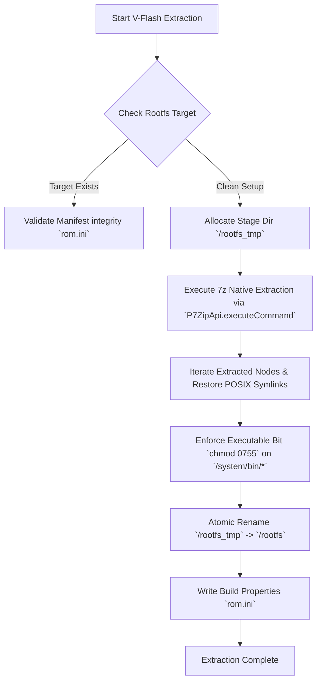

# Virtual Flasher ("V-Flash Engine"): Technical Specification

## 1. Overview & Architectural Goals
The **V-Flash Engine** is VPortable's non-destructive rootfs management and add-on package installation subsystem. In traditional Android environments, flashing add-ons (such as MicroG or OpenGApps) requires custom recovery environments (TWRP, ClockworkMod) operating with root privileges to mount `/system` as read-write, execute recovery shell scripts, and write directly to physical block devices.

In VPortable (`com.m5dev.vportable`), the guest environment runs entirely in user-space without kernel root privileges or raw block storage access. The V-Flash Engine simulates a recovery environment by operating directly on file trees within isolated app storage (`/data/data/com.m5dev.vportable/rootfs`).

### Key Design Requirements:
1. **Clean Rootfs Bootstrapping:** Decompress and initialize a lightweight Android 9 (Pie) base image from a compressed archive (`.7z` / `.tar.xz`).
2. **Virtual Recovery Simulation:** Parse zip packages (MicroG / OpenGApps), analyze `updater-script` / installation manifests, and merge system files directly into the rootfs.
3. **Non-Destructive Delta Merging:** Support atomic package updates, overlays, and add-on removal without corrupting the core system image.
4. **Permissions & Ownership Sanitization:** Explicitly apply POSIX permissions, UID/GID owner mappings (`root`, `system`), and SELinux xattr stubs without requiring kernel `chown` or `chmod` permissions.

---

## 2. Base Rootfs Extraction & Unpack Logic

VPortable inspects and draws inspiration from Twoyi's `RomManager.java` implementation (`com.hzy.libp7zip.P7ZipApi` and `SevenZFile`), optimizing archive extraction for performance, atomic safety, and Bionic symlink preservation.

### 2.1 Storage Layout
All rootfs files are isolated inside host application storage:
```
/data/data/com.m5dev.vportable/
├── files/
│   └── rootfs_archive.7z             # Staged compressed archive
└── rootfs/                            # Target extracted rootfs root
    ├── system/                        # Android System Partition
    │   ├── app/
    │   ├── priv-app/                  # Privileged System Apps
    │   ├── etc/
    │   │   └── permissions/           # System Permission XML Whitelists
    │   └── framework/
    ├── data/                          # Android Data Partition
    ├── dev/                           # Virtualized Device Nodes (Directory-backed)
    ├── proc/                          # Procfs Mountpoint
    └── sys/                           # Sysfs Mountpoint
```

### 2.2 Extraction Pipeline


### 2.3 Symlink & Special File Preservation
Standard Java `ZipInputStream` and basic unarchivers drop POSIX symbolic links and file modes. The V-Flash engine utilizes native 7z extraction (`lib7z` native library) paired with a post-processing pass:
- **Symlink Restoration:** Symlink entry metadata recorded in `.7z` headers are reconstructed using native POSIX `symlinkat(target, dirfd, linkpath)` syscalls.
- **File Permissions:** Executables under `/system/bin`, `/system/xbin`, and shared libraries under `/system/lib64` receive POSIX mode `0755` (`rwxr-xr-x`) or `0644` (`rw-r--r--`).

---

## 3. Flashable Package (ZIP) Processing Engine

V-Flash processes add-on packages such as **MicroG GmsCore** and **OpenGApps** without executing arbitrary recovery shell binaries, preventing incompatible recovery scripts from failing in user-space.

### 3.1 OpenGApps & MicroG Package Analysis
1. **OpenGApps Structures:**
   - Contains architecture-specific tarball payloads (`app-priv.tar.xz`, `framework.tar.xz`, `etc.tar.xz`).
   - Contains installer script `bk-install.sh` and permission definitions `privapp-permissions-*.xml`.
2. **MicroG Package Structures:**
   - Package structure includes `GmsCore.apk`, `ServicesFrameworkProxy.apk`, `FakeStore.apk`, and system permission XMLs.

### 3.2 Automated Package Parser & Injector Algorithm
The V-Flash engine bypasses Edify/Installer scripts (`META-INF/com/google/android/update-binary`) and directly performs a **Manifest-Driven Installation**:

```
Package ZIP
  ├── Core APKs/
  │     ├── GmsCore.apk           --> /system/priv-app/GmsCore/GmsCore.apk
  │     ├── GsfProxy.apk          --> /system/priv-app/GsfProxy/GsfProxy.apk
  │     └── FakeStore.apk         --> /system/priv-app/FakeStore/FakeStore.apk
  ├── System Permissions/
  │     └── privapp-permissions-google.xml --> /system/etc/permissions/privapp-permissions-google.xml
  └── Native Libraries/
        └── lib/arm64-v8a/*.so    --> /system/lib64/
```

---

## 4. UID / GID Ownership & Permission Mapping Table

In a standard Android system, file ownership determines security boundaries. Under PRoot, host execution runs entirely under a single Android app UID (e.g., `u0_a142` = UID `10142`). V-Flash writes files with host UID/GID but records virtual metadata in a PRoot translation database or metadata file.

| Target Path | Target Owner (Virtual UID/GID) | Target Mode | Description |
| :--- | :--- | :--- | :--- |
| `/system/bin/*` | `root:shell` (0:2000) | `0755` | System binaries and executables |
| `/system/priv-app/*` | `root:root` (0:0) | `0755` (dir) / `0644` (file) | Privileged system applications |
| `/system/etc/permissions/*` | `root:root` (0:0) | `0644` | Framework permission grants |
| `/data/system/*` | `system:system` (1000:1000) | `0771` | System configuration data |
| `/data/app/*` | `system:system` (1000:1000) | `0771` | Installed user applications |

### 4.1 Signature Spoofing Reality & Framework Patching Requirement
> **Architectural Correction:** Simply dropping a permission XML defining `android.permission.FAKE_PACKAGE_SIGNATURE` into `/system/etc/permissions/` does **not** enable signature spoofing on vanilla AOSP. Stock AOSP `PackageManagerService` (PMS) contains zero internal support or recognition for `FAKE_PACKAGE_SIGNATURE`. In a vanilla AOSP rootfs, permission XML drops for `FAKE_PACKAGE_SIGNATURE` are completely ignored and silently fail.

To enable MicroG Google Services emulation, the base Android 9 rootfs **must incorporate framework-level signature spoofing patches**:
1. **Pre-Patched AOSP Rootfs (Primary Strategy):** The base Android 9 system image (`services.jar` / `framework.jar`) is pre-compiled with the LineageOS for microG signature spoofing patch directly integrated into `com.android.server.pm.PackageManagerService`.
2. **Dynamic Userspace Framework Hooking (Alternative):** Injected at runtime via userspace bytecode manipulation or Java runtime hooking when initializing `system_server`.

Once PMS is patched to support `FAKE_PACKAGE_SIGNATURE`, permission XMLs injected into `/system/etc/permissions/privapp-permissions-microg.xml` grant signature spoofing privileges to GmsCore:

```xml
<?xml version="1.0" encoding="utf-8"?>
<permissions>
    <!-- Requires pre-patched PackageManagerService in base Android 9 rootfs -->
    <privapp-permissions package="com.google.android.gms">
        <permission name="android.permission.FAKE_PACKAGE_SIGNATURE"/>
        <permission name="android.permission.INSTALL_LOCATION_PROVIDER"/>
        <permission name="android.permission.CHANGE_DEVICE_IDLE_TEMP_WHITELIST"/>
        <permission name="android.permission.UPDATE_DEVICE_STATS"/>
    </privapp-permissions>
</permissions>
```

---

## 5. Non-Destructive Delta Management & Overlays

To allow users to modify, reset, or upgrade add-ons without destroying their rootfs, V-Flash implements a lightweight overlay catalog system:

1. **Manifest Tracker (`/data/data/com.m5dev.vportable/vflash_manifest.json`):** Tracks every file injected by a specific ZIP package hash.
2. **Atomic Uninstall:** To remove an add-on, V-Flash reads the manifest, removes injected binaries and permission files, and triggers a PRoot cache flush.
3. **Safety Backup State:** Before applying an add-on, V-Flash creates a lightweight differential snapshot of affected directories (`/system/priv-app`, `/system/etc`).

---

## 6. Process Memory Isolation Caveats in User-Space Sandboxing

Because VPortable operates as a rootless user-space container inside an unprivileged host Android application, traditional Linux kernel-level process isolation between guest processes is subject to architectural constraints.

### 6.1 Syscall Interception vs. Memory Mapping (`mmap`)
- **Syscall Boundaries:** PRoot/Seccomp intercepts and validates control-plane system calls (`openat`, `execve`, `mount`, `socket`, `unlink`). File paths and POSIX privileges are enforced at these interception boundaries.
- **Post-`mmap` Memory Boundary Limitation:** Once a guest sub-process maps memory pages via `mmap()`, direct memory access occurs strictly within CPU user-mode without generating system calls.
- **Same-UID Memory Access:** All guest processes (guest `init`, `servicemanager`, and guest applications) run on the host Linux kernel as child processes under the host application's single unprivileged UID (e.g., `u0_a142`).
- **Consequence:** Under Linux DAC (Discretionary Access Control), processes sharing the same real UID possess permission to issue `process_vm_readv`, `process_vm_writev`, or `ptrace` against sibling processes unless explicitly blocked by host SELinux or `prctl(PR_SET_DUMPABLE)`.

### 6.1 Defense-in-Depth Mitigation
While raw memory isolation between guest processes under a single host UID cannot be enforced purely by kernel boundaries without hardware virtualization, VPortable enforces user-space mitigations:
- Calling `prctl(PR_SET_DUMPABLE, 0)` on spawned guest processes to restrict ptrace attachment by sibling processes.
- Intercepting and blocking `ptrace` and process memory inspection syscalls initiated by untrusted guest app binaries.
