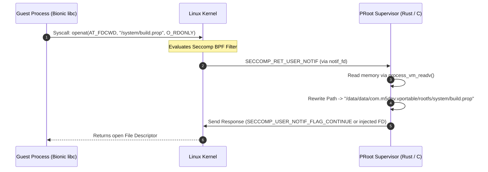

# Execution Engine: Syscall Interception, PRoot & Guest Init

## 1. Overview
The **Execution Engine** is the core container runtime of VPortable (`com.m5dev.vportable`). Its primary responsibility is spawning and supervising the guest Android 9 (Pie) system binaries—including `./init`, `servicemanager`, `zygote`, and guest application processes—within an unprivileged Android user-space environment.

Because standard Android apps run with restricted UIDs (`u0_aXXX`) without kernel root privileges or `CAP_SYS_ADMIN`, guest calls to perform mount operations, access privileged character devices (`/dev/binder`, `/dev/ion`), or manipulate POSIX process credentials (UID/GID 0) are blocked by the Linux kernel. The Execution Engine solves this by intercepting every system call from guest processes and translating or mocking the calls in user-space.

---

## 2. Syscall Interception Architecture: PRoot (`ptrace` + `seccomp-unotify`)

VPortable builds upon the Android fork of PRoot (`termux/proot`) and Mainline PRoot, integrating modern Linux kernel `seccomp-unotify` mechanisms to minimize ptrace tracing overhead.

### 2.1 Syscall Trap Mechanism Comparison

| Mechanism | Trapping Overhead | Execution Path | Android Kernel Compatibility |
| :--- | :--- | :--- | :--- |
| **Pure `ptrace(PTRACE_SYSCALL)`** | High (2 context switches per syscall: entry & exit) | Every single syscall passes through tracee/tracer context switch | Compatible with all Android kernels (3.10+) |
| **`seccomp-unotify` (`SECCOMP_RET_USER_NOTIF`)** | Low (Traps only filtered syscalls) | Non-intercepted syscalls execute at full native speed; intercepted syscalls yield FD notification | Android kernels 5.4+ (Backported to select 4.14/4.19 kernels) |
| **Hybrid Mode (VPortable Default)** | Adaptive / Optimal | Uses `seccomp-unotify` where available; falls back gracefully to `ptrace` tracer loop | Universal Android Device Support |

### 2.2 Seccomp Unotify Flow in Bionic libc Context
When `seccomp-unotify` is supported:
1. VPortable supervisor sets up a Seccomp filter using `seccomp(SECCOMP_SET_MODE_FILTER, SECCOMP_FILTER_FLAG_NEW_LISTENER, &bpf_program)`.
2. Kernel returns a notification file descriptor (`notif_fd`) to the VPortable Rust Runner.
3. Non-sensitive syscalls (`gettimeofday`, `read`, `write` to standard FDs) bypass interception completely.
4. Path-based syscalls (`openat`, `stat`, `execve`, `faccessat`) and privilege syscalls (`setuid`, `getuid`, `mount`, `mknod`) trigger `SECCOMP_RET_USER_NOTIF`.
5. PRoot reads `struct seccomp_notif` from `notif_fd`, performs path rewriting / credential virtualization, and responds with `struct seccomp_notif_resp`.



---

## 3. User-Space Mocking of Device Nodes (`/dev`)

Android system binaries rely heavily on special character devices in `/dev`. In an unprivileged app sandbox, `mknod()` fails with `EPERM`. VPortable creates a directory-backed virtual `/dev` environment inside `/data/data/com.m5dev.vportable/rootfs/dev` and redirects syscalls:

### 3.1 Virtual Device Interception Matrix

| Device Path | Native Kernel Node | VPortable Virtual Redirect / Mock | Interception Strategy |
| :--- | :--- | :--- | :--- |
| `/dev/binder` | IPC Binder Driver | Host `/dev/binder` or binder socket relay | Transparent pass-through with namespace isolation |
| `/dev/ashmem` | Anonymous Shared Memory | Shared Memory FD / POSIX `memfd_create()` | Rewritten to `memfd_create` calls in user-space |
| `/dev/input/*` | Input Event Subsystem | Virtual UNIX Socket / Pipe from Host UI | Injected touch/key events from Host Kotlin `MotionEvent` |
| `/dev/socket/*` | UNIX Domain Sockets | Host private socket directory | Redirection to `/data/data/com.m5dev.vportable/sockets/` |
| `/proc/cpuinfo` | Host Kernel CPU Info | Faked `/system/etc/faked_cpuinfo` | Virtualized CPU features for guest consistency |

---

## 4. Rootless Android 9 `init` Boot sequence

Bootstrapping Android's `./init` binary without root requires neutralising hardcoded kernel privilege assertions.

```mermaid
flowchart TD
    A[Host Launcher Process] --> B[Load Rust Runner `librunner.so`]
    B --> C[Initialize PRoot Environment & Virtual File Trees]
    C --> D[Fork PRoot Supervisor Process]
    D --> E[Exec Guest `/system/bin/init`]
    E --> F{Init Syscall Interception}
    F -- `mount()` --> G[Fake Success Return 0]
    F -- `chown()` / `chmod()` --> H[Update PRoot Virtual Owner DB]
    F -- `setcon()` SELinux --> I[Return SELinux Permissive / Disabled Stub]
    F -- `open("/dev/binder")` --> J[Bind Virtual Binder Node]
    G & H & I & J --> K[Init Spawns `servicemanager`]
    K --> L[Init Spawns `zygote64` / `app_process64`]
    L --> M[System Server Active & Guest Runtime Ready]
```

### Key Hacks for Rootless `init`:
1. **SELinux Emulation:** Intercept `selinuxfs` reads (`/sys/fs/selinux/enforce`) and return `0` (permissive). Intercept `setcon()` and `getcon()` calls, returning faked system contexts (`u:r:init:s0`).
2. **Mount Bypassing:** Android `init.rc` contains numerous `mount` commands (`mount ext4 ...`, `mount tmpfs ...`). PRoot catches these syscalls and returns `0` (`SUCCESS`) while ensuring target directories exist on host disk.
3. **Property Service Integration:** Fakes Android System Properties socket (`/dev/socket/property_service`) so guest processes can call `property_set()` seamlessly.

---

## 5. Twoyi Rust Bridge Runner (`librunner.so`)

VPortable incorporates a Rust-based supervisor runner inspired by Twoyi's Rust bridge (`app/rs/src/lib.rs`). Rust provides memory-safe process control, signal handling, and JNI interoperability.

### Key Responsibilities of Rust Bridge (`lib.rs`):
- **JNI Export Methods:**
  - `Java_com_m5dev_vportable_engine_NativeEngine_startContainer(JNIEnv, class, rootfsPath, config)`
  - `Java_com_m5dev_vportable_engine_NativeEngine_stopContainer(JNIEnv, class)`
- **Signal Handling & Process Cleanup:** Catches `SIGCHLD` when guest processes terminate and prevents zombie process accumulation.
- **FD Passing:** Facilitates passing ANativeWindow / Surface FDs from host Kotlin environment into native renderer threads.
