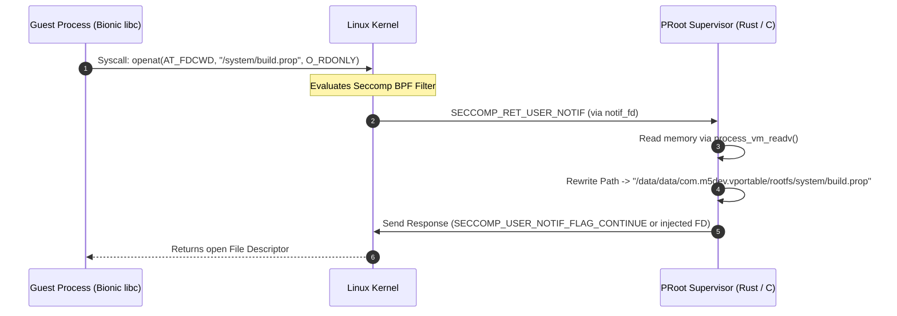

# Execution Engine: Syscall Interception, PRoot & Guest Init

## 1. Overview
The **Execution Engine** is the core container runtime of VPortable (`com.m5dev.vportable`). Its primary responsibility is spawning and supervising the guest Android 9 (Pie) system binaries—including `./init`, `servicemanager`, `zygote`, and guest application processes—within an unprivileged Android user-space environment.

Because standard Android apps run with restricted UIDs (`u0_aXXX`) without kernel root privileges or `CAP_SYS_ADMIN`, guest calls to perform mount operations, access privileged character devices, or manipulate POSIX process credentials (UID/GID 0) are blocked by the Linux kernel. The Execution Engine solves this by intercepting every system call from guest processes and translating or mocking the calls in user-space.

---

## 2. Syscall Interception Architecture: PRoot (`ptrace` + `seccomp-unotify`)

VPortable builds upon the Android fork of PRoot (`termux/proot`) and Mainline PRoot, integrating modern Linux kernel `seccomp-unotify` mechanisms to minimize ptrace tracing overhead.

### 2.1 Syscall Trap Mechanism Comparison

| Mechanism | Trapping Overhead | Execution Path | Android Kernel Compatibility |
| :--- | :--- | :--- | :--- |
| **Pure `ptrace(PTRACE_SYSCALL)`** | High (2 context switches per syscall: entry & exit) | Every single syscall passes through tracee/tracer context switch | Compatible with all Android kernels (3.10+) |
| **`seccomp-unotify` (`SECCOMP_RET_USER_NOTIF`)** | Low (Traps only filtered syscalls) | Non-intercepted syscalls execute at full native speed; intercepted syscalls yield FD notification | Android kernels 5.4+ (Backported to select 4.14/4.19 kernels) |
| **Hybrid Mode (VPortable Default)** | Adaptive / Optimal | Uses `seccomp-unotify` where available; falls back gracefully to `ptrace` tracer loop | Universal Android Device Support |

### 2.2 Seccomp Unotify Flow in Bionic libc Context
When `seccomp-unotify` is supported:
1. VPortable supervisor sets up a Seccomp filter using `seccomp(SECCOMP_SET_MODE_FILTER, SECCOMP_FILTER_FLAG_NEW_LISTENER, &bpf_program)`.
2. Kernel returns a notification file descriptor (`notif_fd`) to the VPortable Rust Runner.
3. Non-sensitive syscalls (`gettimeofday`, `read`, `write` to standard FDs) bypass interception completely.
4. Path-based syscalls (`openat`, `stat`, `execve`, `faccessat`) and privilege syscalls (`setuid`, `getuid`, `mount`, `mknod`) trigger `SECCOMP_RET_USER_NOTIF`.
5. PRoot reads `struct seccomp_notif` from `notif_fd`, performs path rewriting / credential virtualization, and responds with `struct seccomp_notif_resp`.



---

## 3. Host SELinux & OEM Hardening (Samsung Knox / MIUI / EMUI)

### 3.1 Guest Context Mocking vs. Host Kernel Enforcement
> **Crucial Reality:** Mocking `setcon()` and `getcon()` calls inside PRoot **only satisfies guest binaries** that check their own SELinux context. It does **not** alter or relax the host Linux kernel's SELinux policy enforcement.

The VPortable process tree executes under the host Android OS's `untrusted_app` (or `untrusted_app_XX`) SELinux domain. OEM security framework enhancements (Samsung Knox, Xiaomi MIUI, Huawei EMUI) introduce restrictive SEC_SELINUX policies that aggressively restrict untrusted app sandboxes.

### 3.2 OEM Hardware Risks & Mitigation
- **Samsung Knox:** Knox policies frequently restrict `ptrace(PTRACE_ATTACH)`, `ptrace(PTRACE_SYSCALL)`, and `process_vm_readv()` operations for processes running in `untrusted_app` SELinux domains.
- **Xiaomi MIUI / HyperOS:** Aggressive memory-cleaner heuristics kill background processes issuing high numbers of ptrace traps or holding multiple UNIX domain sockets.
- **Huawei EMUI / HarmonyOS:** Disallows `seccomp(SECCOMP_SET_MODE_FILTER, SECCOMP_FILTER_FLAG_NEW_LISTENER)` creation in non-root app sandboxes (`EPERM`).

### 3.3 OEM Compatibility & Fallback Matrix

| OEM Platform | Host SELinux Domain Risk | Feature Impact | Mitigation / Fallback Strategy |
| :--- | :--- | :--- | :--- |
| **Standard AOSP / Pixel** | Low (`untrusted_app`) | Full Support | Standard `seccomp-unotify` + `ptrace` hybrid |
| **Samsung Knox (One UI)** | High (`untrusted_app_27` + Knox) | `ptrace` or `process_vm_readv` blocked by Knox policy | Fall back to Seccomp user notification without ptrace attachment; copy parameters via shared memory pipes |
| **Xiaomi MIUI / HyperOS** | Medium (Memory/Background Killers) | SIGKILL under memory pressure / socket limit | Apply `PTRACE_O_EXITKILL`, register foreground notification service, optimize Zygote memory footprint |
| **Huawei EMUI / HarmonyOS** | High (Strict Syscall Filters) | `seccomp(SECCOMP_FILTER_FLAG_NEW_LISTENER)` denied (`EPERM`) | Fall back gracefully to classic `ptrace(PTRACE_SYSCALL)` tracer loop |

*Note: Real-device physical verification across Samsung Knox, MIUI, and Pixel hardware is a mandatory gating step (Gate 1 in Architecture Roadmap) before proceeding with higher-level Android framework components.*

---

## 4. The `/dev/binder` Reality: Userspace Binder-over-Sockets

### 4.1 The Kernel Binder Passthrough Myth
Earlier container designs assumed guest processes could transparently open and pass through host `/dev/binder`. This assumption is **architecturally impossible on unprivileged Android**:

1. **Single Context Manager Constraint (`BINDER_SET_CONTEXT_MGR`):** The Linux kernel Binder driver (`drivers/android/binder.c`) permits **only one Context Manager** per binder device node.
2. **Host Context Manager Preemption:** On host boot, the host Android OS `servicemanager` daemon claims the single context manager slot on `/dev/binder`.
3. **`EBUSY` / `EPERM` Rejection:** When the guest `servicemanager` attempts to register as a context manager via `ioctl(binder_fd, BINDER_SET_CONTEXT_MGR, 0)`, the kernel driver rejects the request with `EBUSY` or `EPERM`.

### 4.2 Userspace Binder-over-Sockets Solution
To establish inter-process communication within the guest container without kernel driver access, VPortable implements **Userspace Binder-over-Sockets** (utilizing Android 12+ `RpcSession` / userspace `libbinder` emulation over UNIX domain sockets):

```
+---------------------------------------------------------------------------------+
|                         GUEST CONTAINER (Android 9 Rootfs)                      |
|                                                                                 |
|  +------------------------+                     +----------------------------+  |
|  | Guest App / Service    |                     | Guest `servicemanager`     |  |
|  | (Client `BpBinder`)    |                     | (Userspace RPC Server)     |  |
|  +-----------+------------+                     +-------------+--------------+  |
|              |                                                |                 |
|              | Userspace `libbinder` (RPC Transport Protocol)  |                 |
|              v                                                v                 |
|  +---------------------------------------------------------------------------+  |
|  |            UNIX Domain Socket (`/dev/socket/binder_vportable`)            |  |
|  +---------------------------------------------------------------------------+  |
+---------------------------------------------------------------------------------+
```

- **Transport:** Standard Linux UNIX domain sockets (`/dev/socket/binder_vportable`) replace Binder kernel ioctls (`BINDER_WRITE_READ`).
- **IPC Protocol:** Marshals AIDL parcel transactions (`binder_transaction_data`) over socket streams using `RpcServer` / `RpcSession` socket-based binder transport.

---

## 5. User-Space Mocking of Device Nodes (`/dev`)

Android system binaries rely heavily on special character devices in `/dev`. In an unprivileged app sandbox, `mknod()` fails with `EPERM`. VPortable creates a directory-backed virtual `/dev` environment inside `/data/data/com.m5dev.vportable/rootfs/dev` and redirects syscalls:

### 5.1 Virtual Device Interception Matrix

| Device Path | Native Kernel Node | VPortable Virtual Redirect / Mock | Interception Strategy |
| :--- | :--- | :--- | :--- |
| `/dev/binder` | IPC Binder Driver | Userspace Binder UNIX Socket | Intercept `open()` and redirect to `/dev/socket/binder_vportable` |
| `/dev/ashmem` | Anonymous Shared Memory | Shared Memory FD / POSIX `memfd_create()` | Rewritten to `memfd_create` calls in user-space |
| `/dev/input/*` | Input Event Subsystem | Virtual UNIX Socket / Pipe from Host UI | Injected touch/key events from Host Kotlin `MotionEvent` |
| `/dev/socket/*` | UNIX Domain Sockets | Host private socket directory | Redirection to `/data/data/com.m5dev.vportable/sockets/` |
| `/proc/cpuinfo` | Host Kernel CPU Info | Faked `/system/etc/faked_cpuinfo` | Virtualized CPU features for guest consistency |

---

## 6. Supervisor Concurrency, Performance & Process Cleanup

### 6.1 Bottleneck Analysis: `process_vm_readv()` Memory Reading
When guest processes issue path-based syscalls (`openat`, `stat`, `execve`), the supervisor reads string arguments from guest memory using `process_vm_readv()`. During Zygote preloading—when hundreds of DEX/JAR files, APKs, and shared libraries are opened sequentially—a naive single-threaded supervisor loop creates severe I/O bottlenecks and serialization lag.

### 6.2 Multi-Threaded `epoll`-Driven Dispatch Loop
To maximize throughput, VPortable implements a multi-threaded, event-driven supervisor dispatch engine:
- **`epoll` Event Multiplexing:** A master supervisor thread manages an `epoll` instance listening on Seccomp notification file descriptors (`notif_fd`) and ptrace signal queues.
- **Worker Thread Pool:** Incoming syscall events are dispatched to a lock-free worker thread pool for parallel path translation and memory reading.
- **Path Translation Cache:** Frequently accessed system paths (`/system/framework/*`, `/system/lib64/*`) are cached in an in-memory hash map to avoid redundant `process_vm_readv()` calls.

```
+---------------------------------------------------------------------------------+
|                       VPORTABLE SUPERVISOR DISPATCH LOOP                        |
|                                                                                 |
|  +---------------------------------------------------------------------------+  |
|  |                 Master Event Loop (`epoll_wait` on `notif_fd`)            |  |
|  +-------------------------------------+-------------------------------------+  |
|                                        | Dispatch Event                         |
|                    +-------------------+-------------------+                    |
|                    |                                       |                    |
|                    v                                       v                    |
|  +-----------------------------------+   +-----------------------------------+  |
|  | Worker Thread 1                   |   | Worker Thread N                   |  |
|  | - Read guest path                 |   | - Read guest path                 |  |
|  | - Consult Path Cache              |   | - Consult Path Cache              |  |
|  | - Rewrite & Respond               |   | - Rewrite & Respond               |  |
|  +-----------------------------------+   +-----------------------------------+  |
+---------------------------------------------------------------------------------+
```

### 6.3 Orphan Process Cleanup & Process-Group Reaping
Preventing zombie processes and orphan leaks when the guest container stops or crashes is enforced via kernel mechanisms:
- **`PTRACE_O_EXITKILL` Enforce:** When attaching or tracing guest child processes, the supervisor sets `ptrace(PTRACE_SETOPTIONS, child_pid, 0, PTRACE_O_EXITKILL)`. If the supervisor process terminates abnormally, the Linux kernel automatically delivers `SIGKILL` to every traced child process.
- **Process Group Signal Reaping:** The Rust bridge (`librunner.so`) registers a `SIGCHLD` handler combined with non-blocking `waitpid(-1, &status, WNOHANG)` loops to clean up terminated guest sub-processes and prevent PID exhaustion.

---

## 7. Rootless Android 9 `init` Boot sequence

Bootstrapping Android's `./init` binary without root requires neutralizing hardcoded kernel privilege assertions.

```mermaid
flowchart TD
    A[Host Launcher Process] --> B[Load Rust Runner `librunner.so`]
    B --> C[Initialize PRoot Environment & Virtual File Trees]
    C --> D[Fork PRoot Multi-Threaded Supervisor]
    D --> E[Exec Guest `/system/bin/init`]
    E --> F{Init Syscall Interception}
    F -- `mount()` --> G[Fake Success Return 0]
    F -- `chown()` / `chmod()` --> H[Update PRoot Virtual Owner DB]
    F -- `setcon()` SELinux --> I[Return SELinux Permissive / Disabled Stub]
    F -- `open("/dev/binder")` --> J[Redirect to Userspace Binder Socket]
    G & H & I & J --> K[Init Spawns Userspace `servicemanager`]
    K --> L[Init Spawns `zygote64` / `app_process64`]
    L --> M[System Server Active & Guest Runtime Ready]
```

### Key Hacks for Rootless `init`:
1. **SELinux Emulation:** Intercept `selinuxfs` reads (`/sys/fs/selinux/enforce`) and return `0` (permissive). Intercept `setcon()` and `getcon()` calls, returning faked system contexts (`u:r:init:s0`).
2. **Mount Bypassing:** Android `init.rc` contains numerous `mount` commands (`mount ext4 ...`, `mount tmpfs ...`). PRoot catches these syscalls and returns `0` (`SUCCESS`) while ensuring target directories exist on host disk.
3. **Property Service Integration:** Fakes Android System Properties socket (`/dev/socket/property_service`) so guest processes can call `property_set()` seamlessly.

---

## 8. Twoyi Rust Bridge Runner (`librunner.so`)

VPortable incorporates a Rust-based supervisor runner inspired by Twoyi's Rust bridge (`app/rs/src/lib.rs`). Rust provides memory-safe process control, signal handling, and JNI interoperability.

### Key Responsibilities of Rust Bridge (`lib.rs`):
- **JNI Export Methods:**
  - `Java_com_m5dev_vportable_engine_NativeEngine_startContainer(JNIEnv, class, rootfsPath, config)`
  - `Java_com_m5dev_vportable_engine_NativeEngine_stopContainer(JNIEnv, class)`
- **Signal Handling & Process Cleanup:** Catches `SIGCHLD` when guest processes terminate and prevents zombie process accumulation.
- **FD Passing:** Facilitates passing ANativeWindow / Surface FDs from host Kotlin environment into native renderer threads.
