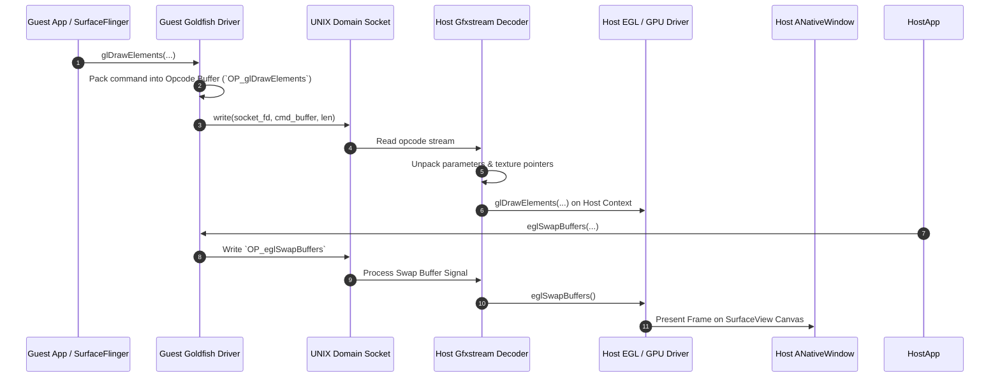

# Graphics Pipeline: Host-Guest Rendering Subsystem

## 1. Overview & Performance Requirements
Achieving smooth, low-latency display execution inside a rootless user-space container requires direct, hardware-accelerated rendering. Standard software rendering (e.g., `libGLX_swrast`) results in unacceptably high CPU overhead and poor frame rates (below 15 FPS).

VPortable (`com.m5dev.vportable`) adapts the **AOSP Goldfish OpenGL** / **Gfxstream** architecture utilized by the Android Emulator and container engines (Waydroid). Rather than rendering to a virtual QEMU frame buffer, VPortable pipes OpenGL ES (GLES) and EGL command streams from guest processes directly to the host's GPU via local UNIX domain sockets, rendering onto a host Android `SurfaceView` / `ANativeWindow`.

---

## 2. Architecture Comparison: Standard Guest Rendering vs. VPortable Gfxstream Pipeline

### Standard Android Container Rendering (Waydroid / Emulator)
- Requires kernel DRM / KMS device access (`/dev/dri/renderD128`).
- Dependent on host kernel virtio-gpu driver and root-level permission grants.

### VPortable Host-Guest Graphics Architecture
- Operates entirely in user-space without `/dev/dri` access.
- Guest graphics driver marshals OpenGL ES commands into wire protocol packets (`GoldfishOpcode`).
- Socket stream sent over local UNIX domain socket (`/dev/socket/gfxstream_vportable`).
- Host process deserializes wire packets using Goldfish host decoder and executes calls directly on host EGL context.

```
+---------------------------------------------------------------------------------+
|                        GUEST CONTAINER (Android 9 Rootfs)                       |
|                                                                                 |
|  +--------------------+   +-----------------------+   +----------------------+  |
|  | Guest Application  |   | Guest SurfaceFlinger  |   |  Guest EGL / GLES    |  |
|  +---------+----------+   +-----------+-----------+   |     Client Driver    |  |
|            |                          |               +----------+-----------+  |
|            +--------------------------+                          |              |
|                                                                  v              |
|                                                  +---------------------------+  |
|                                                  | Goldfish / Gfxstream Pipe |  |
|                                                  |   (Opcode Serialization)  |  |
|                                                  +-------------+-------------+  |
+----------------------------------------------------------------|----------------+
                                                                 | UNIX Socket
                                                                 v Stream
+----------------------------------------------------------------|----------------+
|                        HOST SYSTEM (Android App)               |                |
|                                                                v                |
|                                                  +---------------------------+  |
|                                                  | Gfxstream Host Decoder    |  |
|                                                  +-------------+-------------+  |
|                                                                |                |
|  +-------------------------------------------------------------+                |
|  | Direct Host EGL / GLES Calls                                                 |
|  v                                                                              |
|  +-----------------------------+               +-----------------------------+  |
|  | Host EGL Context / Display  | ------------> | Host Android `SurfaceView`  |  |
|  +-----------------------------+               |     / `ANativeWindow`       |  |
|                                                +-----------------------------+  |
+---------------------------------------------------------------------------------+
```

---

## 3. Command Stream Flow & Opcode Serialization

The guest application renders via standard EGL / GLES APIs (`libEGL_goldfish.so`, `libGLESv2_goldfish.so`).



---

## 4. Native Window & Surface Synchronization

To bridge host Kotlin UI components with native rendering threads, VPortable uses `ANativeWindow` references passed via JNI:

### 4.1 Native Binding Pipeline:
1. **Kotlin UI Layer:** Initializes a `SurfaceView` inside Jetpack Compose UI layout.
2. **Surface Lifecycle Callback:** When `surfaceCreated(SurfaceHolder holder)` triggers, host obtains the native `ANativeWindow` pointer via Bionic NDK `ANativeWindow_fromSurface(env, surface)`.
3. **Rust / C++ Renderer Initialization:** Host passes `ANativeWindow*` pointer to the Gfxstream host decoder engine.
4. **EGL Surface Creation:**
   ```c
   // Host Native Code Initialization
   EGLDisplay display = eglGetDisplay(EGL_DEFAULT_DISPLAY);
   eglInitialize(display, &major, &minor);

   EGLConfig config;
   EGLint num_configs;
   eglChooseConfig(display, attrib_list, &config, 1, &num_configs);

   // Create EGL Window Surface backed by Host ANativeWindow
   EGLSurface surface = eglCreateWindowSurface(display, config, nativeWindow, NULL);
   EGLContext context = eglCreateContext(display, config, EGL_NO_CONTEXT, context_attribs);
   eglMakeCurrent(display, surface, surface, context);
   ```

---

## 5. Latency Minimization & Buffer Sharing

To maintain 60+ FPS without input lag:
1. **Double / Triple Buffering:** Guest `SurfaceFlinger` allocates buffer rings.
2. **Memfd / Shared Memory Allocation:** For large texture updates (`glTexImage2D`), pixel data is transferred via shared memory file descriptors (`memfd_create`) passed over socket control messages (`SCM_RIGHTS`), avoiding double-copy overhead over socket streams.
3. **VSync Alignment:** Host `Choreographer` signals VSync events to guest `SurfaceFlinger` through a virtual VSync pipe.
